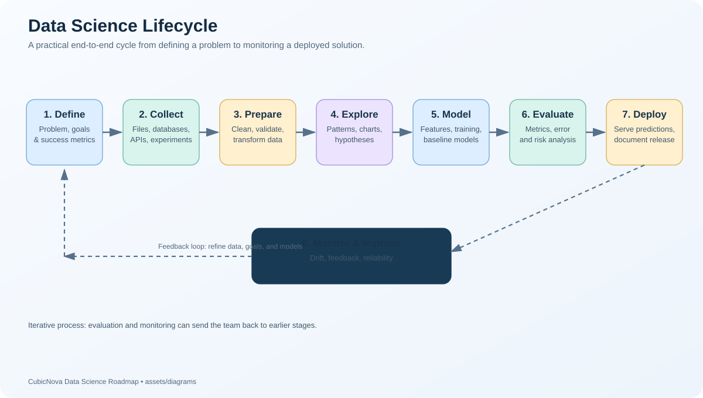

# Contributing to the CubicNova Data Science Roadmap

Thank you for your interest in improving the **CubicNova Data Science Roadmap**!

This repository is a beginner-friendly, practical learning resource covering Python, mathematics, statistics, data analysis, machine learning, deep learning, Generative AI, data engineering, MLOps, projects, interview preparation, and related topics.

Contributions of all sizes are welcome—from fixing a typo or broken link to adding a tutorial, exercise, project, or diagram. The goal is to keep the roadmap **accurate, accessible, practical, well-organized, and useful for learners at different levels**.

- **Repository:** [CubicNova/Data-Science-Roadmap](https://github.com/cubicnova/Data-Science-Roadmap)
- **Main README:** [README.md](./README.md)
- **Resources:** [15-Resources](./15-Resources/)
- **Diagrams:** [assets/diagrams](./assets/diagrams/)

## Table of Contents

- [Ways to Contribute](#ways-to-contribute)
- [Before You Start](#before-you-start)
- [Getting Started](#getting-started)
- [Content Guidelines](#content-guidelines)
- [Markdown and Documentation Standards](#markdown-and-documentation-standards)
- [Python Code and Notebook Guidelines](#python-code-and-notebook-guidelines)
- [Diagram and Asset Guidelines](#diagram-and-asset-guidelines)
- [Dataset and Attribution Guidelines](#dataset-and-attribution-guidelines)
- [Suggested Content Structure](#suggested-content-structure)
- [Pull Request Process](#pull-request-process)
- [Commit Message Guidelines](#commit-message-guidelines)
- [Contributor Checklist](#contributor-checklist)
- [Community Expectations](#community-expectations)
- [Questions and Support](#questions-and-support)

## Ways to Contribute

You can help by:

- Correcting spelling, grammar, formatting, or technical errors.
- Fixing broken links and outdated instructions.
- Improving explanations for beginners.
- Adding examples, exercises, quizzes, and solutions.
- Creating or improving cheat sheets.
- Adding reproducible notebooks and small projects.
- Creating diagrams for workflows, algorithms, and architectures.
- Suggesting reputable books, free courses, datasets, and documentation.
- Adding interview questions, coding challenges, and case studies.
- Improving accessibility, navigation, and cross-links between topics.
- Reporting missing topics or proposing improvements through GitHub Issues.

If you are unsure whether a large change fits the roadmap, open an issue first to discuss the proposed scope.

## Before You Start

1. Read the repository's [README.md](./README.md) and the README in the relevant topic directory.
2. Search existing files and [Issues](https://github.com/cubicnova/Data-Science-Roadmap/issues) to avoid duplicating work.
3. For substantial changes, open an issue describing the problem, proposed solution, and intended audience.
4. Make changes focused on one topic or purpose at a time.
5. Be respectful of existing structure and naming conventions.

## Getting Started

### Option A: Edit on GitHub

For small changes, such as correcting a typo or fixing a link:

1. Open the file in the repository.
2. Select the pencil icon to edit it.
3. Make the change and preview the Markdown.
4. Add a clear commit message.
5. Commit the change or create a pull request, depending on your repository permissions.

### Option B: Work locally

#### 1. Fork or clone the repository

If you do not have write access, fork the repository on GitHub and clone your fork. If you do have write access, you can clone the main repository and work on a separate branch.

```bash
git clone https://github.com/cubicnova/Data-Science-Roadmap.git
cd Data-Science-Roadmap
```

If working from your fork, replace the URL with your fork's clone URL.

#### 2. Create a branch

Use a short, descriptive branch name.

```bash
git checkout -b docs/improve-python-guide
```

Other examples:

```text
docs/fix-broken-links
content/add-pandas-exercises
diagram/add-ml-workflow
project/add-sales-analysis
```

#### 3. Make and review your changes

- Keep changes focused and easy to review.
- Follow the content and formatting guidelines below.
- Preview Markdown and open diagrams or notebooks to check rendering.
- Test code examples where practical.

#### 4. Commit and push

```bash
git add path/to/changed-files
git commit -m "Improve Python learning guide"
git push -u origin docs/improve-python-guide
```

Use your actual branch name and changed paths. If you cloned the main repository and do not have permission to push, fork the repository and push the branch to your fork instead.

#### 5. Open a pull request

Open a pull request against the repository's default branch. Explain what changed, why it is useful, and how you checked it. Link a related issue when applicable.

For more details, see GitHub's guide to [contributing to open source](https://docs.github.com/en/get-started/exploring-projects-on-github/contributing-to-open-source).

## Content Guidelines

Contributions should support the roadmap's goal of teaching Data Science through clear explanations and practical learning.

### Write for learners

- State the purpose of a topic before introducing complex details.
- Explain new terminology before relying on it.
- Prefer clear language and short paragraphs.
- Include practical examples when they improve understanding.
- Distinguish beginner material from intermediate or advanced material.
- Explain not only how a technique works, but when and why it is useful.
- Identify assumptions, limitations, and common mistakes.

### Keep technical content accurate

- Verify formulas, code, commands, and technical claims.
- Prefer official documentation, reputable textbooks, research papers, or established educational sources.
- Link to sources for claims that need verification.
- Use consistent terminology and notation.
- Avoid presenting an illustrative example as a universal rule.
- Do not promise a particular model accuracy or business outcome without evidence.

### Prefer hands-on learning

Where appropriate, include:

- A learning objective.
- A short conceptual explanation.
- A worked example.
- Exercises or questions.
- Expected output or evaluation criteria.
- Common errors and troubleshooting tips.
- Further reading.

Do not add code or sections merely to make a page longer. Each section should help the reader learn or apply the topic.

## Markdown and Documentation Standards

Use GitHub-flavored Markdown and keep documents consistent.

### Headings

- Use one top-level `#` heading per file.
- Use headings in a logical hierarchy (`##`, then `###`).
- Use descriptive headings that make pages easy to scan.

### Code blocks

Always specify a language where possible:

````markdown
```python
import pandas as pd

df = pd.read_csv("data.csv")
print(df.head())
```
````

Use `text` for plain terminal output and `bash` for shell commands. Explain what a command does when it is not self-explanatory.

### Links and images

- Prefer descriptive link text over phrases such as “click here.”
- Use relative links for files inside this repository.
- Check that internal links and image paths work.
- Add meaningful alt text to informative images.

Example from the repository root:

```markdown

```

### Tables and lists

Use tables for compact comparisons. Use lists for steps, checklists, and related items. Avoid very wide tables that are difficult to read on mobile devices.

### File names

Use descriptive, lowercase names with hyphens where appropriate, for example:

```text
pandas-groupby-examples.md
model-evaluation.md
data-science-lifecycle.svg
```

Follow the existing naming convention of the directory you are updating.

## Python Code and Notebook Guidelines

Code examples should be correct, readable, and suitable for the intended learner level.

- Use clear variable and function names.
- Prefer small, focused examples over unnecessarily complex code.
- Include required imports and state any package dependencies.
- Avoid machine-specific file paths.
- Use relative paths or explain how a learner should obtain the data.
- Set random seeds when reproducibility is important.
- Explain non-obvious steps and important parameters.
- Include expected output when it helps verify the result.
- Handle missing values and common errors where relevant.
- Do not include API keys, passwords, access tokens, private datasets, or other secrets.
- Avoid unnecessary dependencies and very large notebook outputs.
- Clear irrelevant execution output before committing notebooks.
- Test notebook cells in order when practical.

For machine learning examples, be especially careful about data leakage. Split data appropriately, fit preprocessing on training data only, and use a validation set or cross-validation for model selection. Keep the test set for final evaluation.

When relevant, include evaluation metrics and explain why they are appropriate for the task.

## Diagram and Asset Guidelines

Visual explanations are an important part of this roadmap. Diagrams belong in [`assets/diagrams/`](./assets/diagrams/).

### Preferred formats

- **SVG:** preferred for flowcharts, architectures, and diagrams with labels because it scales cleanly.
- **PNG:** appropriate for raster graphics or when SVG is unsuitable.
- **Mermaid (`.mmd` or Markdown code blocks):** useful for text-based, editable diagrams.
- **Draw.io (`.drawio`):** useful when a diagram needs visual editing in diagrams.net.

When practical, include an editable source file alongside the rendered asset.

### Diagram requirements

- Give each diagram a clear purpose and readable title.
- Use accurate labels and a logical flow.
- Keep text legible at typical documentation sizes.
- Use consistent styling across related diagrams.
- Avoid unnecessary decoration and overly dense layouts.
- Verify that arrows, labels, and relationships are correct.
- Provide attribution and follow the source's license when using external assets.
- Preview SVG files and check that they render correctly on GitHub.
- Update [`assets/diagrams/README.md`](./assets/diagrams/README.md) when adding or renaming diagrams.

Use lowercase, hyphenated filenames such as `machine-learning-workflow.svg`.

## Dataset and Attribution Guidelines

- Use public datasets that are suitable for educational use.
- Check the dataset's license and terms before redistributing it.
- Include the original dataset link and relevant attribution.
- Do not commit private, confidential, personal, or sensitive data.
- Avoid committing large datasets when a download link or small sample is sufficient.
- If you create a sample dataset, explain how it was generated.
- Attribute external text, images, diagrams, code, and research appropriately.
- Do not copy substantial material from books, courses, websites, or other repositories without permission.
- Prefer original explanations and examples, with links to source material for further study.

## Suggested Content Structure

Follow the structure already used in the target directory. For a new topic, a useful starting point might be:

```text
topic-name/
├── README.md
├── theory.md
├── examples/
├── exercises/
├── solutions/
└── resources.md
```

This is a suggested pattern, not a requirement for every topic. Simple topics may need only a `README.md` or a single Markdown file. Do not create empty files or folders just to match this example.

For a lesson, consider including:

1. Overview and learning objectives.
2. Prerequisites.
3. Core concepts.
4. Examples or visual explanations.
5. Exercises or a practical task.
6. Common mistakes and troubleshooting.
7. Summary and further resources.

For a project, consider including the problem statement, dataset source, setup instructions, methodology, results, limitations, and steps to reproduce the work.

## Pull Request Process

A good pull request should be focused, clearly described, and ready for review.

1. **Describe the change.** Explain the problem it solves or the learning gap it fills.
2. **Keep scope focused.** Avoid combining unrelated edits in one pull request.
3. **Check your work.** Review spelling, formatting, links, code, and diagrams.
4. **Provide context.** Include screenshots for meaningful visual changes when useful.
5. **Link relevant issues.** Reference a related issue when one exists.
6. **Respond to feedback.** Make requested changes in the same pull request when possible.
7. **Update documentation.** If a change affects navigation or related pages, update their links as well.

Maintainers may request clarification or revisions before accepting a contribution. Please do not assume a pull request has been accepted until it is merged.

### Suggested pull request description

```markdown
## Summary
Describe what changed.

## Motivation
Explain why this change is useful for learners.

## Changes made
- List the main additions or updates.

## Validation
- [ ] Checked Markdown formatting and links
- [ ] Tested code examples, where applicable
- [ ] Previewed diagrams or notebooks, where applicable
- [ ] Checked attribution and licensing

## Related issue
Closes #<issue-number>
```

Remove any checklist item that does not apply. Do not invent an issue number.

## Commit Message Guidelines

Use short, descriptive commit messages that explain the change.

Examples:

```text
docs: improve statistics guide
content: add pandas exercises
fix: correct broken resource links
diagram: add machine learning workflow
project: add sales analysis example
```

These prefixes are suggested conventions. Keep commits focused and avoid vague messages such as `update files` or `changes`.

## Contributor Checklist

Before submitting a contribution, review the relevant items:

- [ ] The change fits the roadmap's scope.
- [ ] The content is accurate and beginner-friendly.
- [ ] Headings, file names, and formatting follow existing conventions.
- [ ] Internal links and image paths have been checked.
- [ ] Code examples have been tested where practical.
- [ ] Diagrams render correctly and have readable labels.
- [ ] Dataset, image, and source attributions are included where needed.
- [ ] No credentials, secrets, private data, or unnecessary large files are included.
- [ ] Related README files or navigation links have been updated.
- [ ] The pull request explains the purpose and validation.

Not every item applies to every change; complete the checks relevant to your contribution.

## Community Expectations

Help keep the project welcoming and constructive.

- Be respectful and considerate.
- Give feedback about the work, not the person.
- Explain disagreements with evidence and clear reasoning.
- Welcome questions from beginners.
- Assume good intent and communicate professionally.
- Do not post spam, harassment, private information, or discriminatory content.

## Questions and Support

If you have an idea, find an error, or need clarification:

- [Open an Issue](https://github.com/cubicnova/Data-Science-Roadmap/issues)
- [Browse the Repository](https://github.com/cubicnova/Data-Science-Roadmap)
- Review the relevant topic's `README.md` before proposing a new page.

Thank you for helping make the CubicNova Data Science Roadmap more accurate, practical, and accessible.

**Learn together. Build together. Keep improving.**
