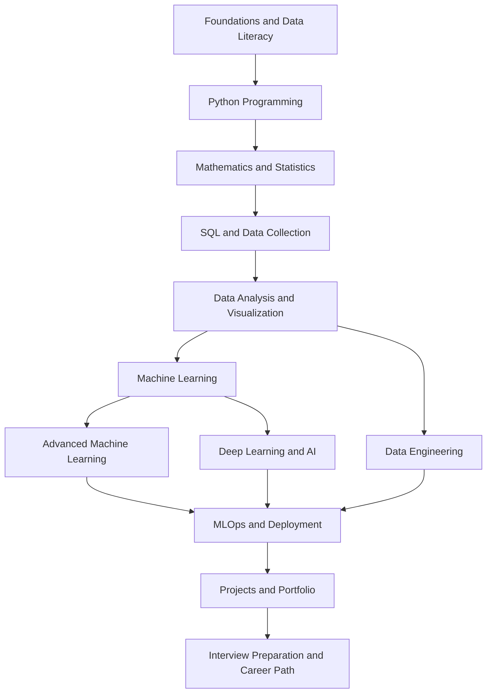

# 🗺️ Data Science Roadmap

Welcome to the **CubicNova Data Science Roadmap** — a structured, practical learning path for building skills in Data Science, Data Analytics, Machine Learning, Deep Learning, Generative AI, Data Engineering, and MLOps.

**Start with the fundamentals, practice each stage, and build projects as you learn.** You do not need to master every topic at once. Follow the core path first, then choose a specialization based on your interests and goals.

## 📑 Table of Contents

- [About This Roadmap](#-about-this-roadmap)
- [How to Use the Roadmap](#-how-to-use-the-roadmap)
- [Roadmap at a Glance](#-roadmap-at-a-glance)
- [Stage 1: Foundations](#-stage-1-foundations)
- [Stage 2: Python Programming](#-stage-2-python-programming)
- [Stage 3: Mathematics and Statistics](#-stage-3-mathematics-and-statistics)
- [Stage 4: Data Collection and Databases](#-stage-4-data-collection-and-databases)
- [Stage 5: Data Analysis and Visualization](#-stage-5-data-analysis-and-visualization)
- [Stage 6: Machine Learning](#-stage-6-machine-learning)
- [Stage 7: Advanced Machine Learning](#-stage-7-advanced-machine-learning)
- [Stage 8: Deep Learning and AI](#-stage-8-deep-learning-and-ai)
- [Stage 9: Data Engineering](#-stage-9-data-engineering)
- [Stage 10: MLOps and Deployment](#-stage-10-mlops-and-deployment)
- [Stage 11: Projects and Portfolio](#-stage-11-projects-and-portfolio)
- [Stage 12: Interview Preparation](#-stage-12-interview-preparation)
- [Choose Your Career Path](#-choose-your-career-path)
- [Recommended Tools](#-recommended-tools)
- [Learning Resources](#-learning-resources)
- [Progress Checklist](#-progress-checklist)
- [Contribution Guidelines](#-contribution-guidelines)

## 🎯 About This Roadmap

Data Science combines programming, statistics, domain knowledge, and analytical thinking to extract insights from data and support decisions. Depending on the role, it can also involve building predictive models, deploying AI systems, and maintaining data pipelines.

This roadmap is designed to help learners:

- Progress from core programming and data literacy to advanced topics.
- Understand how concepts connect to real-world workflows.
- Practice with exercises, datasets, and projects.
- Find useful documentation, books, courses, and cheat sheets.
- Build a public portfolio that demonstrates practical skills.

The roadmap is a guide, not a rigid rulebook. Adjust the order and depth to your background, target role, and available time.

## 🧭 How to Use the Roadmap

1. **Assess your current level.** If you are new to programming, start with foundations and Python.
2. **Follow prerequisites.** Build Python, statistics, and data handling skills before going deep into machine learning.
3. **Learn actively.** Write code, solve exercises, and explain concepts in your own words.
4. **Build as you go.** Complete a small project after each major stage.
5. **Use official documentation.** Treat courses as guided introductions and documentation as a long-term reference.
6. **Review regularly.** Revisit weak topics instead of rushing forward.
7. **Choose a specialization.** Once the core is solid, focus on analytics, ML engineering, AI, data engineering, or another target role.

> **Recommended study balance:** Spend time learning concepts, writing code, solving problems, and building projects. Passive watching alone is not enough.

## 🧱 Roadmap at a Glance

## 🌱 Stage 1: Foundations

**Goal:** Understand data, basic computing, problem-solving, and the tools used throughout the roadmap.

### Topics

- What is Data Science?
- Data Science vs. Data Analytics vs. AI vs. Machine Learning
- Data types, data formats, and data quality
- Computational thinking and problem decomposition
- Basic command-line usage
- Files, folders, and environment setup
- Git and GitHub fundamentals
- Privacy, responsible data use, and reproducibility

### Practice

- Identify useful questions in a public dataset.
- Create a GitHub repository for your learning notes.
- Use Git to track a small Python project.

**Completion milestone:** Explain the purpose of a data science workflow and manage a simple project with Git.

## 🐍 Stage 2: Python Programming

**Goal:** Write readable Python code and use it to solve small problems.

### Topics

- Variables, data types, and operators
- Strings and collections
- Conditions and loops
- Functions and modules
- File handling and exceptions
- Comprehensions and iterators
- Object-oriented programming fundamentals
- Virtual environments and package installation
- Debugging and basic testing
- Working with CSV, JSON, and APIs

### Practice projects

- Expense tracker
- CSV summary tool
- Log file analyzer
- Simple API data collector

**Completion milestone:** Write small programs independently, organize code into functions, and install dependencies in a project environment.

## 📐 Stage 3: Mathematics and Statistics

**Goal:** Develop the mathematical intuition needed to analyze data and understand machine learning.

### Mathematics

- Algebra and functions
- Vectors and matrices
- Linear algebra operations
- Derivatives and gradients
- Basic optimization concepts

### Statistics and probability

- Mean, median, mode, variance, and standard deviation
- Probability rules and conditional probability
- Common probability distributions
- Sampling and sampling bias
- Confidence intervals
- Hypothesis testing
- Correlation and covariance
- Regression fundamentals
- Bayesian reasoning

### Practice

- Summarize a dataset statistically.
- Compare distributions using plots.
- Investigate a claim using a suitable statistical method.

**Completion milestone:** Explain key statistical measures, uncertainty, and the assumptions behind a basic analysis.

## 🗄️ Stage 4: Data Collection and Databases

**Goal:** Obtain, query, and understand data from common sources.

### Topics

- CSV, JSON, and spreadsheet data
- SQL fundamentals
- Filtering, sorting, and aggregation
- Joins, subqueries, and common table expressions
- Window functions
- Relational database design
- Data collection through APIs
- Responsible web data collection
- Data validation and quality checks

### Practice projects

- E-commerce SQL analysis
- API-to-CSV collection tool
- Customer transaction report
- Database-backed analytics project

**Completion milestone:** Query relational data, combine tables, and document where a dataset came from.

## 📊 Stage 5: Data Analysis and Visualization

**Goal:** Transform raw data into useful, well-supported insights.

### Topics

- NumPy arrays and vectorized operations
- Pandas Series and DataFrames
- Missing values and duplicates
- Data type conversion and text cleaning
- Filtering, grouping, merging, and reshaping
- Exploratory data analysis (EDA)
- Matplotlib and Seaborn
- Interactive visualization with Plotly
- Dashboard fundamentals
- Data storytelling and communicating findings

### Practice projects

- Retail sales analysis
- Customer behavior analysis
- Public dataset exploration
- Business KPI dashboard

**Completion milestone:** Produce a reproducible analysis with documented cleaning steps, meaningful charts, and clear conclusions.

## 🤖 Stage 6: Machine Learning

**Goal:** Train and evaluate classical machine learning models.

### Topics

- Supervised and unsupervised learning
- Regression and classification
- Decision trees and ensemble methods
- Clustering
- Feature engineering and selection
- Train, validation, and test splits
- Cross-validation
- Evaluation metrics
- Overfitting, underfitting, and regularization
- Hyperparameter tuning
- Scikit-learn pipelines
- Data leakage prevention

### Practice projects

- House price prediction
- Customer churn prediction
- Customer segmentation
- Fraud detection baseline
- Sales forecasting baseline

**Completion milestone:** Build a complete baseline model, select suitable metrics, compare alternatives, and explain model limitations.

## 🧠 Stage 7: Advanced Machine Learning

**Goal:** Improve model performance, reliability, and interpretability.

### Topics

- Ensemble learning and gradient boosting
- Imbalanced datasets
- Anomaly detection
- Dimensionality reduction
- Time-series forecasting
- Model calibration
- Explainable AI and feature importance
- Error analysis
- Robustness, fairness, and model limitations
- Experiment design and model selection

### Practice projects

- Explainable credit risk model
- Imbalanced fraud classification
- Demand forecasting
- Anomaly detection on operational metrics

**Completion milestone:** Justify modeling choices and evaluate trade-offs beyond a single accuracy score.

## 🧬 Stage 8: Deep Learning and AI

**Goal:** Understand neural networks and explore specialized AI domains.

### Deep learning fundamentals

- Neural network architecture
- Activation and loss functions
- Forward propagation and backpropagation
- Gradient-based optimization
- Regularization and dropout
- Training and validation workflows
- GPU fundamentals and transfer learning

### Choose a specialization

**Natural Language Processing**
- Text preprocessing and tokenization
- Text classification and embeddings
- Transformers and language models

**Computer Vision**
- Image processing
- Convolutional neural networks
- Image classification and object detection
- Transfer learning

**Generative AI and LLMs**
- Transformer concepts and tokenization
- Prompt design and structured outputs
- Embeddings and semantic search
- Retrieval-augmented generation (RAG)
- Evaluation, privacy, and safety

**Reinforcement Learning**
- States, actions, rewards, and environments
- Value-based and policy-based approaches

### Practice projects

- Image classifier
- Text sentiment analysis
- Document question-answering prototype
- Semantic search application

**Completion milestone:** Build one focused AI project and explain its data, evaluation approach, limitations, and responsible-use considerations.

## 🏗️ Stage 9: Data Engineering

**Goal:** Understand how data is moved, transformed, stored, and made available for analytics and ML.

### Topics

- ETL and ELT
- Data pipelines and workflow orchestration
- Data warehouses and data lakes
- Data modeling
- Batch and streaming concepts
- Apache Spark fundamentals
- Data quality and validation
- Pipeline logging and monitoring

### Practice projects

- Scheduled data ingestion pipeline
- SQL-based transformation workflow
- Analytics warehouse for sample sales data
- Data quality validation checks

**Completion milestone:** Build a repeatable pipeline that collects, transforms, validates, and stores data.

## 🚀 Stage 10: MLOps and Deployment

**Goal:** Package and maintain models beyond the notebook.

### Topics

- Saving and loading trained models
- REST APIs for inference
- FastAPI fundamentals
- Docker and containers
- Experiment tracking and model versioning
- Automated tests and CI/CD
- Model deployment patterns
- Monitoring latency, errors, and data drift
- Reproducible training
- Secrets management and deployment security

### Practice projects

- Deploy a model with FastAPI
- Containerize a prediction service
- Track experiments with MLflow
- Add automated checks to a model repository
- Create a model monitoring report

**Completion milestone:** Deploy a reproducible model service and document how to test, monitor, and update it.

## 🧰 Stage 11: Projects and Portfolio

**Goal:** Demonstrate that you can apply skills to real problems.

Build projects that increase in scope and complexity.

### Beginner

- [ ] Python data utility
- [ ] SQL analysis
- [ ] Exploratory data analysis notebook
- [ ] Data visualization report

### Intermediate

- [ ] End-to-end classification or regression
- [ ] Dashboard with a business narrative
- [ ] Customer segmentation
- [ ] Time-series analysis

### Advanced

- [ ] Reproducible ML pipeline
- [ ] Deployed ML API
- [ ] NLP, computer vision, or RAG application
- [ ] Data engineering pipeline with validation and monitoring

### Each project should include

- Problem statement and objective
- Dataset source and licensing information
- Setup and reproduction instructions
- Data preparation and methodology
- Results and appropriate evaluation metrics
- Limitations and future improvements
- Clear README and relevant visualizations

Avoid publishing sensitive data, secrets, or datasets you do not have permission to redistribute.

## 🎯 Stage 12: Interview Preparation

**Goal:** Prepare to explain concepts, solve problems, and discuss your own work.

### Areas to practice

- Python programming and problem-solving
- SQL queries and data manipulation
- Probability and statistics
- Exploratory data analysis
- Machine learning concepts and evaluation
- Model debugging and error analysis
- Project walkthroughs and trade-offs
- Behavioral questions and communication

### Practice methods

- Solve coding challenges consistently.
- Explain concepts aloud without reading notes.
- Reproduce one project from a clean environment.
- Practice SQL on sample databases.
- Prepare to explain why you selected particular metrics and models.
- Review mistakes and revisit weak areas.

**Completion milestone:** Explain your projects clearly, solve representative technical questions, and discuss limitations and alternatives.

## 🧭 Choose Your Career Path

Complete the core foundations first, then prioritize topics based on your target role.

| Career Path | Recommended Focus |
|---|---|
| Data Analyst | SQL, spreadsheets, Pandas, statistics, visualization, BI dashboards |
| Data Scientist | Statistics, EDA, ML, experimentation, communication, projects |
| Machine Learning Engineer | ML, software engineering, APIs, Docker, testing, MLOps |
| AI Engineer | Deep learning, LLMs, embeddings, RAG, evaluation, deployment |
| Data Engineer | SQL, Python, data modeling, pipelines, orchestration, distributed processing |
| BI Developer | SQL, dimensional modeling, Power BI or Tableau, business metrics |
| Research-oriented ML | Mathematics, statistics, papers, experimental methods, deep learning |

These paths overlap. Job requirements vary by organization and seniority, so use current job descriptions to identify the skills most relevant to your goals.

## 🛠️ Recommended Tools

| Area | Tools |
|---|---|
| Programming | Python, Jupyter, VS Code |
| Version control | Git, GitHub |
| Data manipulation | NumPy, Pandas |
| Visualization | Matplotlib, Seaborn, Plotly |
| Databases | PostgreSQL, SQLite |
| Machine learning | scikit-learn, XGBoost |
| Deep learning | PyTorch, TensorFlow |
| NLP and LLMs | Hugging Face ecosystem |
| Data engineering | SQL, Spark, Airflow, dbt |
| Deployment | FastAPI, Docker |
| MLOps | MLflow, CI/CD tools |
| Practice | Kaggle, UCI Machine Learning Repository, Google Colab |

You do not need to learn every tool. Choose a small, coherent set that supports your current stage and target role.

## 📚 Learning Resources

Use the repository's learning materials alongside the roadmap.

- [Free Courses](./15-Resources/Free-Courses.md)
- [Recommended Books](./15-Resources/Books.md)
- [Cheatsheets](./14-Cheatsheets/)
- [Diagrams](./assets/diagrams/)
- [Interview Preparation](./13-Interview-Preparation/)

For external learning, prefer official documentation, reputable educational institutions, open textbooks, and courses with practical exercises. Check access terms before assuming a course or certificate is free.

## ✅ Progress Checklist

Use this checklist to track your overall progress.

- [ ] Foundations and Git
- [ ] Python programming
- [ ] Mathematics and statistics
- [ ] SQL and data collection
- [ ] Data analysis and visualization
- [ ] Core machine learning
- [ ] Advanced machine learning
- [ ] One AI specialization
- [ ] Data engineering fundamentals
- [ ] Model deployment and MLOps
- [ ] Portfolio projects
- [ ] Interview preparation

You can revisit this checklist as your goals change. Progress is measured by what you can explain, implement, evaluate, and communicate—not by how many courses you have watched.

## 🤝 Contribution Guidelines

Help make the roadmap more accurate, practical, and accessible.

- Read [CONTRIBUTING.md](./CONTRIBUTING.md) before making substantial changes.
- Follow the [Code of Conduct](./CODE-OF-CONDUCT.md).
- Report issues or suggest improvements through [GitHub Issues](https://github.com/cubicnova/Data-Science-Roadmap/issues).
- Use clear explanations, tested examples, working links, and appropriate attribution.
- Keep changes focused and update related navigation when adding or renaming files.

## 🌟 Final Advice

Do not try to learn every branch of Data Science simultaneously. Build strong fundamentals, practice on real data, and finish projects that demonstrate your skills. Advanced topics become easier when the basics are reliable.

**Learn consistently. Practice deliberately. Build projects. Share what you learn.**

Maintained by **CubicNova** as an open learning resource for the Data Science community.
